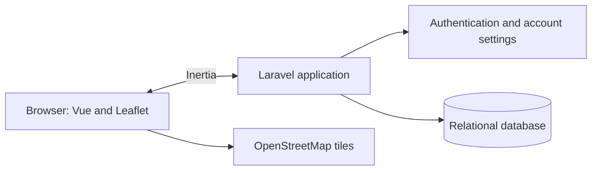

# TripPlanner — project introduction

## What is TripPlanner?

TripPlanner is a small web application for planning trips on a map. The project
is intended to grow into a place where people can build routes, add useful
information to stops, and keep their travel plans together. The longer-term
direction is described in [Introduction.md](./Introduction.md).

This repository is also a learning project: it is a way to gain practical
experience with Laravel, Vue, and the work involved in developing and operating
a web application.

## Project stage: version 0.1

TripPlanner is currently at version **0.1**: an early setup and starting point
for further development, rather than a complete trip-planning product. The
application has a working foundation for accounts and a first, browser-based
route-planning experience. Much of the wider product idea is still to be
designed and built.

In this early version, users can:

- register, sign in, and manage basic account settings;
- open an authenticated dashboard;
- create a route by adding and removing points on a map;
- add names, tags, and descriptions to sample route waypoints.

Routes and waypoint details are currently held in frontend state or sample
data. They are not saved as trips in the application database. Sharing, groups,
chat, exports, and place recommendations are future possibilities, not
implemented features.

## How the application is put together

TripPlanner uses a server-backed application with a Vue single-page experience.
Laravel handles web routes, authentication, validation, and server responses.
Inertia connects those responses to Vue pages without requiring a separate API
for the current screens. Vue and TypeScript handle the interface and its
interactive state. Leaflet displays the map and route in the browser.

The database currently supports users and framework features such as sessions.
There are not yet trip or waypoint tables. The map uses OpenStreetMap tiles,
with Leaflet Routing Machine used to draw routes between points.

## Main technologies

- **Backend:** PHP 8.2+, Laravel 12, and Eloquent
- **Frontend:** Vue 3, TypeScript, Inertia.js, and Vite
- **Styling:** Tailwind CSS
- **Mapping:** Leaflet, Leaflet Routing Machine, and OpenStreetMap tiles

