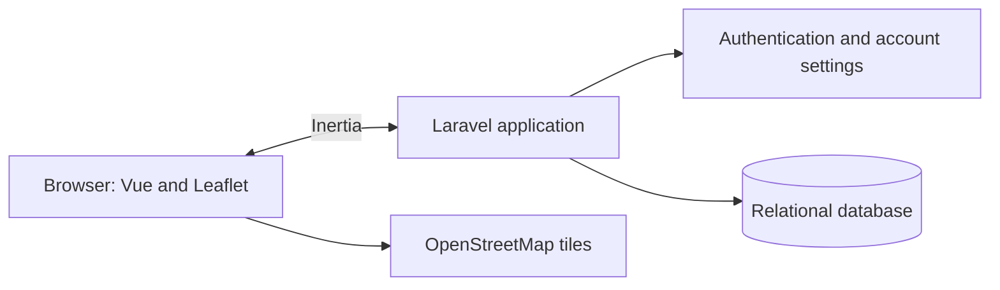

# TripPlanner — project introduction

## What is TripPlanner?

TripPlanner is a small web application for planning trips on a map. The project
is intended to grow into a place where people can build routes, add useful
information to stops, and keep their travel plans together. The longer-term
direction is described in [Introduction.md](./Introduction.md).

This repository is also a learning project: it is a way to gain practical
experience with Laravel, Vue, and the work involved in developing and operating
a web application.

## Project stage: version 0.5

TripPlanner is currently at version **0.5**. The trip editor, dashboard, and
Notes page use database-backed trips belonging to the signed-in user. Users can
save and edit routes, waypoint details, notes, and tags across sessions. Accounts
and the core trip workflow are implemented; sharing, groups, and chat remain
future work, while exports and recommendations still use sample data.

In this early version, users can:

- register, sign in, and manage basic account settings;
- open an authenticated dashboard;
- create a route by adding and removing points on a map;
- add names, tags, and descriptions to saved route waypoints, choosing tags
  from a database catalog or entering custom names;
- export sample trips in basic GPX and KML formats or open them in supported map apps;
- browse a basic recommendations page with sample routes and map previews.

Trips can be created, reloaded, updated, and deleted through authenticated
HTTP routes. Name, notes, and trip tags can be edited; saved waypoint positions
can be updated in the trip editor.
The dashboard reads only the current user's saved trips. New trips open at
`/trips/create`; saved trips open at `/trips/{trip}/edit`. Export is a
prototype that prepares files and map links from the sample trip data; it does
not yet export persisted or fully routed trip geometry. Recommendations are a
basic view of sample routes, not a recommendation service. Public sharing,
groups, and chat remain future possibilities.

## How the application is put together

TripPlanner uses a server-backed application with a Vue single-page experience.
Laravel handles web routes, authentication, validation, and server responses.
Inertia connects those responses to Vue pages without requiring a separate API
for the current screens. Vue and TypeScript handle the interface and its
interactive state. Leaflet displays the map and route in the browser.

The database supports users and framework features such as sessions, plus
trip, waypoint, waypoint tag, and trip tag persistence through Eloquent models
and migrations. Trips use nullable `notes` for their full description; there is no separate summary. The planned editor
contract is defined in `resources/js/types/trip.ts`; Form Requests validate
writes, and owner-scoped queries protect reads, updates, and deletes.
The trip editor lists map waypoints beside the map and accepts optional waypoint
names when creating or editing a trip. Saved routes can add and remove points. Names are validated and stored with the coordinates.
The Notes page is separate from Plan and loads only the signed-in user’s trips.
It saves trip notes and tags plus waypoint names, descriptions, and tags together
in a transaction through an authenticated, validated endpoint. The trip editor shows the editable saved route; its form omits
trip notes and trip tag fields.
The catalog is populated by
`WaypointTagPresetSeeder`. Schema conventions are documented
in [decisions.md](./decisions.md). The map uses OpenStreetMap tiles,
with Leaflet Routing Machine used to draw routes between points.

## Main technologies

- **Backend:** PHP 8.2+, Laravel 12, and Eloquent
- **Frontend:** Vue 3, TypeScript, Inertia.js, and Vite
- **Styling:** Tailwind CSS
- **Mapping:** Leaflet, Leaflet Routing Machine, and OpenStreetMap tiles

## Configurable page availability

`config/features.php` registers environment-wide page states. `FeatureRegistry`
normalizes them for `EnsureFeatureEnabled` and shared Inertia props. Page routes
explicitly use the `page` middleware parameter; maintenance renders a generic
Inertia page without running the original controller. Actions and data routes
return 503 in maintenance, while hidden features return 404. Vue navigation
filters hidden features; `FeatureAction` renders native disabled buttons for
unavailable actions. No database tables or domain dependencies are introduced.

`AvailablePageResolver` selects the first enabled entry route allowed by known
authentication, verification and gate middleware, falling back to the public
home page. Unknown middleware is not assumed to allow access. Auth redirects,
logos and the delete-trip redirect use this shared decision. Intended URLs must
be local, belong to an allowed entry/settings route and pass the same checks;
Notes selections additionally require ownership. Parameterized destinations are
conservatively replaced with the entry fallback rather than automatically
redirecting into an object whose authorization has not been evaluated.
